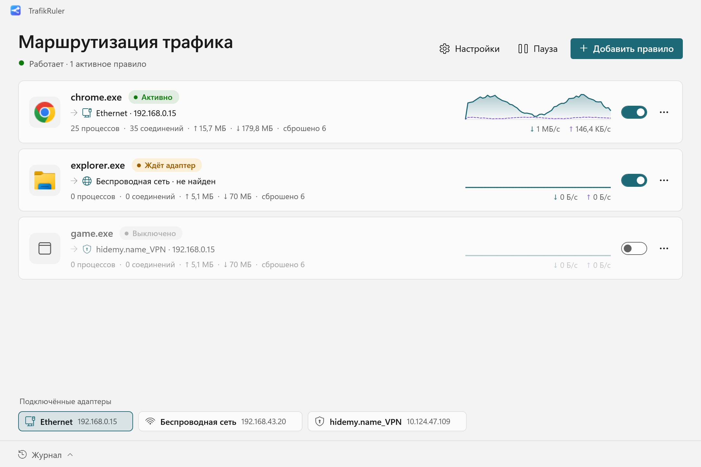
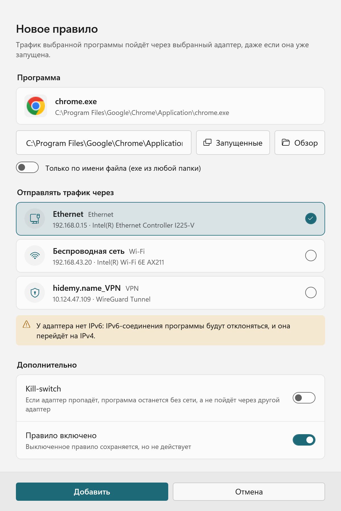
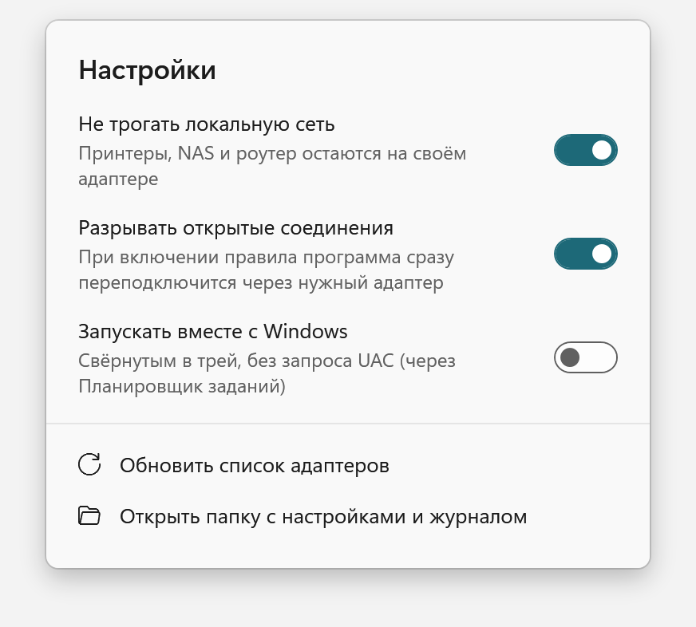
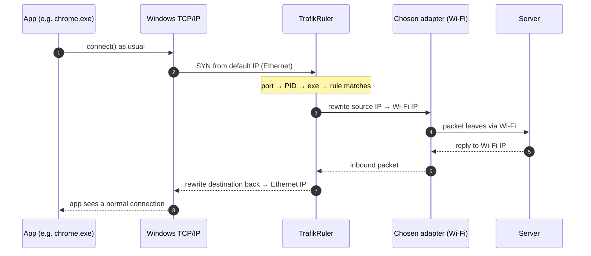

<div align="center">


# TrafikRuler

**Per-app network routing for Windows. Pick an app, pick an adapter — done.**

Send one program through Wi‑Fi, another through Ethernet, a third through your VPN or LTE modem.
Works on apps that are **already running**. No restarts, no DLL injection, no proxies.

[](https://github.com/li4inka/trafik-ruler/actions/workflows/ci.yml)
[](https://github.com/li4inka/trafik-ruler/releases/latest)
[](https://github.com/li4inka/trafik-ruler/releases)
[](LICENSE)
[](#requirements)
[](https://dotnet.microsoft.com/download/dotnet/8.0)

[**Download**](https://github.com/li4inka/trafik-ruler/releases/latest) ·
[How it works](#how-it-works) ·
[FAQ](#faq) ·
[Build from source](#build-from-source) ·
[Русский](README.ru.md)

<picture>
  <source media="(prefers-color-scheme: dark)" srcset="docs/assets/screenshot-dark.png">
  
</picture>

</div>

## Why

Windows picks a network interface **per destination**, never per application. If you have Ethernet *and* Wi‑Fi, a VPN *and* a home connection, or a laptop with an LTE modem, every program goes through whatever the routing table says — and there is no built-in way to change that for one app.

TrafikRuler adds the missing switch:

- 🎮 **Game on Ethernet, downloads on Wi‑Fi.** Keep latency low while a torrent client saturates the other link.
- 🔒 **Only this app through the VPN** — or the opposite: one app *around* the VPN, everything else inside it.
- 📶 **Use your phone's hotspot or an LTE modem for a single program** without touching the rest of the system.
- 🧪 **Test from a different network** — your app sees a different external IP, nothing else changes.

## Features

| | |
|---|---|
| ⚡ **Works on running apps** | Rules apply instantly. Existing TCP connections are reset so the app reconnects through the new adapter. |
| 🧩 **No injection** | Nothing is loaded into the target process. Routing happens at the packet level. |
| 🔌 **Any adapter** | Ethernet, Wi‑Fi, VPN (WireGuard, OpenVPN, …), USB/LTE modems, phone tethering. |
| 🛑 **Kill switch** | If the chosen adapter disappears, the app is cut off instead of silently falling back. |
| 🏠 **LAN stays local** | Printers, NAS and your router keep working on their usual adapter. |
| 🌐 **IPv4 + IPv6** | Full IPv6 NAT when the adapter has it; otherwise IPv6 is refused so the app falls back to IPv4 fast. |
| 📈 **Live stats** | Per-rule speed graphs, connections, traffic counters, adapter throughput. |
| 🪟 **Native Windows 11 look** | Fluent design, Mica, light/dark theme and accent color follow your system. Lives in the tray. |
| 🪶 **Tiny** | ~0.5 MB executable. Crashes or exits? Your network instantly goes back to normal. |

<details>
<summary><b>More screenshots</b></summary>
<br>
<p align="center">
<picture>
  <source media="(prefers-color-scheme: dark)" srcset="docs/assets/rule-dark.png">
  
</picture>
&nbsp;
<picture>
  <source media="(prefers-color-scheme: dark)" srcset="docs/assets/settings-dark.png">
  
</picture>
</p>
</details>

> **Note:** the interface is currently in Russian. English localization is the [#1 item on the roadmap](#roadmap) — contributions welcome!

## Quick start

1. Download the latest **`TrafikRuler-*-win-x64.zip`** from [Releases](https://github.com/li4inka/trafik-ruler/releases/latest) and unzip it anywhere.
2. Run **`TrafikRuler.exe`** and accept the UAC prompt (packet routing requires administrator rights).
   If the [.NET 8 Desktop Runtime](https://dotnet.microsoft.com/download/dotnet/8.0) is missing, Windows will offer to download it from Microsoft.
3. Click **Add rule**, choose a program (from the running list or by path), choose an adapter, save.

That's it. Close the window to keep TrafikRuler running in the tray; enable *Start with Windows* in Settings to have it on every boot.

### Requirements

- Windows 10 or 11, x64
- [.NET 8 Desktop Runtime](https://dotnet.microsoft.com/download/dotnet/8.0)
- Administrator rights
- The target adapter must have a route to the internet (a default gateway)

### About the Microsoft Defender warning

TrafikRuler uses [WinDivert](https://github.com/basil00/WinDivert), a signed, open-source packet capture driver. Microsoft Defender classifies WinDivert itself as **`HackTool:Win64/WinDivert`** — a *potentially unwanted application* category applied to packet-interception tools in general, not a virus detection. The same driver powers well-known projects such as GoodbyeDPI, zapret and Clumsy.

We don't hide this or try to work around it. If Defender removes `WinDivert.dll`/`WinDivert64.sys`, you can allow **only this specific detection**: *Windows Security → Virus & threat protection → Protection history → HackTool:Win64/WinDivert → Actions → Allow on device*. Verify the files first: `WinDivert64.sys` must carry a valid Authenticode signature, and every release lists SHA256 checksums.

## How it works

Windows decides the outgoing interface from the packet's **source address** (the *strong host* model). TrafikRuler intercepts packets with WinDivert and performs per-process NAT:



- **Process detection** — socket events from WinDivert map local ports to PIDs before the first packet; the IP Helper tables are a fallback.
- **Already-running apps** — open TCP connections can't change their address mid-flight, so they're reset (`SetTcpEntry` for IPv4, an injected RST for IPv6) and the app reconnects via the new route.
- **Correctness details** — incremental checksum updates (RFC 1624), TCP MSS clamping to the target adapter's MTU, IPv4 fragment tracking, endpoint-independent UDP mapping for P2P/STUN.
- **Fail-open** — if TrafikRuler stops, the driver handle closes and traffic flows exactly as before.

More detail for contributors: [docs/architecture.md](docs/architecture.md).

## How it compares

| | TrafikRuler | ForceBindIP | `route add` | VPN split tunneling |
|---|:---:|:---:|:---:|:---:|
| Per application | ✅ | ✅ | ❌ per destination | ✅ |
| Apps already running | ✅ | ❌ launch only | — | depends on client |
| No code injected into the app | ✅ | ❌ DLL injection | ✅ | ✅ |
| Any adapter, not just "VPN or not" | ✅ | ✅ | ✅ | ❌ |
| Kill switch | ✅ | ❌ | ❌ | depends on client |
| GUI with live stats | ✅ | ❌ | ❌ | depends on client |

## FAQ

<details>
<summary><b>Does it work with games and anti-cheat?</b></summary>

TrafikRuler never injects code into the game process, which is what usually upsets anti-cheat software. However, some anti-cheat systems may object to packet-filter drivers being loaded at all. This hasn't been tested systematically — reports in [Issues](https://github.com/li4inka/trafik-ruler/issues) are very welcome.
</details>

<details>
<summary><b>Why do DNS queries still go through the default adapter?</b></summary>

Most apps don't resolve names themselves — the Windows DNS Client service (`svchost.exe`) does it for them. The app's actual connections go through the chosen adapter; per-app DNS routing is on the roadmap.
</details>

<details>
<summary><b>Can I send one app around my VPN?</b></summary>

Yes, unless your VPN client has its own kill switch ("block untunneled traffic"), which drops anything that doesn't go through the tunnel at the Windows Filtering Platform level. Sending an app *into* the VPN adapter always works.
</details>

<details>
<summary><b>Does it slow down my connection?</b></summary>

Only while at least one rule is active, all outgoing TCP/UDP packets pass through TrafikRuler (unrelated flows are passed through on a fast path). At home broadband speeds it's unnoticeable; on multi-gigabit links it may become a bottleneck. With no active rules, nothing is intercepted at all.
</details>

<details>
<summary><b>What happens if TrafikRuler crashes?</b></summary>

The WinDivert handle is closed by the OS and traffic immediately returns to the normal routing table. Connections that were being translated reconnect over the default route.
</details>

<details>
<summary><b>Where are my settings?</b></summary>

`%AppData%\TrafikRuler\settings.json` and `log.txt`. Uninstalling is deleting the folder (and disabling *Start with Windows* first, if you enabled it).
</details>

## Build from source

Requirements: .NET SDK 8+ on Windows.

```powershell
git clone https://github.com/li4inka/trafik-ruler.git
cd trafik-ruler

# WinDivert binaries are not stored in the repo. This downloads 2.2.2-A from the official
# release and checks the files against pinned SHA256 hashes and the driver signature.
powershell -ExecutionPolicy Bypass -File scripts\get-windivert.ps1

dotnet test                                                     # 50+ unit & UI tests
dotnet publish src\TrafikRuler -c Release -r win-x64 -o publish # single ~0.5 MB exe
```

Defender may delete the WinDivert download — see the note [above](#about-the-microsoft-defender-warning).

<details>
<summary>Self-contained build (~65 MB, no .NET runtime needed)</summary>

```powershell
dotnet publish src\TrafikRuler -c Release -r win-x64 --self-contained true `
  -p:IncludeNativeLibrariesForSelfExtract=true -p:EnableCompressionInSingleFile=true -o publish\standalone
```
</details>

## Roadmap

- [ ] English UI and localization infrastructure
- [ ] Command-line interface for scripting
- [ ] Per-app DNS routing
- [ ] Code-signed releases and a `winget` package
- [ ] Rules by process tree (include child processes)
- [ ] ARM64 build

Have an idea? [Open a feature request](https://github.com/li4inka/trafik-ruler/issues/new/choose).

## Contributing

Bug reports, translations and pull requests are welcome! Start with [CONTRIBUTING.md](CONTRIBUTING.md). Please follow the [Code of Conduct](CODE_OF_CONDUCT.md), and report security issues privately as described in [SECURITY.md](SECURITY.md).

If TrafikRuler saves you some hassle, **a ⭐ helps other people find it.**

## License

TrafikRuler is free software, licensed under the [GNU General Public License v3.0](LICENSE).
Copyright © 2026 kulich Software.

Release archives include [WinDivert](https://github.com/basil00/WinDivert) by basil00 (LGPL-3.0) — see [THIRD_PARTY_NOTICES.md](THIRD_PARTY_NOTICES.md).

## Acknowledgments

- [WinDivert](https://github.com/basil00/WinDivert) by basil00 — the driver that makes packet-level routing possible in user mode.
- Inspired by the long-standing absence of per-app routing in Windows, and by everyone who has ever asked "how do I make *just this app* use Wi‑Fi?"

<div align="center">

[](https://star-history.com/#li4inka/trafik-ruler&Date)

</div>
