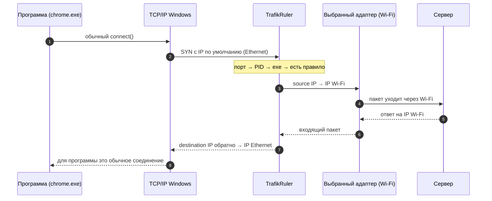

<div align="center">


# TrafikRuler

**Маршрутизация трафика по программам для Windows. Выбрали программу, выбрали адаптер — готово.**

Одна программа идёт через Wi‑Fi, другая через Ethernet, третья через VPN или LTE-модем.
Работает с **уже запущенными** программами: без перезапуска, без внедрения DLL, без прокси.

[](https://github.com/li4inka/trafik-ruler/actions/workflows/ci.yml)
[](https://github.com/li4inka/trafik-ruler/releases/latest)
[](https://github.com/li4inka/trafik-ruler/releases)
[](LICENSE)
[](#требования)
[](https://dotnet.microsoft.com/download/dotnet/8.0)

[**Скачать**](https://github.com/li4inka/trafik-ruler/releases/latest) ·
[Как это работает](#как-это-работает) ·
[Вопросы и ответы](#вопросы-и-ответы) ·
[Сборка из исходников](#сборка-из-исходников) ·
[English](README.md)

<picture>
  <source media="(prefers-color-scheme: dark)" srcset="docs/assets/screenshot-dark.png">
  
</picture>

</div>

## Зачем

Windows выбирает сетевой интерфейс **по адресу назначения**, а не по программе. Если у вас есть и Ethernet, и Wi‑Fi, VPN и домашнее подключение, или ноутбук с LTE-модемом, все программы идут туда, куда укажет таблица маршрутов. Штатно изменить это для одной программы нельзя.

TrafikRuler добавляет этот недостающий переключатель:

- 🎮 **Игра через Ethernet, загрузки через Wi‑Fi.** Пинг остаётся низким, пока торрент-клиент забивает другой канал.
- 🔒 **Только эта программа через VPN** — или наоборот: одна программа *мимо* VPN, всё остальное внутри.
- 📶 **Раздача с телефона или LTE-модем для одной программы**, не трогая остальную систему.
- 🧪 **Проверка из другой сети**: у программы другой внешний IP, больше ничего не меняется.

## Возможности

| | |
|---|---|
| ⚡ **Работает с запущенными программами** | Правило действует сразу. Открытые TCP-соединения сбрасываются, и программа переподключается через новый адаптер. |
| 🧩 **Без внедрения кода** | В процесс программы ничего не загружается, маршрутизация работает на уровне пакетов. |
| 🔌 **Любой адаптер** | Ethernet, Wi‑Fi, VPN (WireGuard, OpenVPN и др.), USB/LTE-модемы, раздача с телефона. |
| 🛑 **Kill-switch** | Если выбранный адаптер пропал, программа остаётся без сети, а не уходит молча через другой. |
| 🏠 **Локальная сеть остаётся локальной** | Принтеры, NAS и роутер работают через свой обычный адаптер. |
| 🌐 **IPv4 и IPv6** | Полноценный NAT для IPv6, если он есть у адаптера; иначе IPv6 отклоняется, и программа быстро переходит на IPv4. |
| 📈 **Живая статистика** | Графики скорости по правилам, соединения, счётчики трафика, скорость адаптеров. |
| 🪟 **Родной вид Windows 11** | Fluent, Mica, светлая и тёмная тема и акцентный цвет берутся из системы. Живёт в трее. |
| 🪶 **Маленький** | Exe ~0,5 МБ. Упал или закрылся — сеть сразу работает как обычно. |

<details>
<summary><b>Ещё скриншоты</b></summary>
<br>
<p align="center">
<picture>
  <source media="(prefers-color-scheme: dark)" srcset="docs/assets/rule-dark.png">
  
</picture>
&nbsp;
<picture>
  <source media="(prefers-color-scheme: dark)" srcset="docs/assets/settings-dark.png">
  
</picture>
</p>
</details>

## Быстрый старт

1. Скачайте свежий **`TrafikRuler-*-win-x64.zip`** со страницы [Releases](https://github.com/li4inka/trafik-ruler/releases/latest) и распакуйте в любую папку.
2. Запустите **`TrafikRuler.exe`** и подтвердите запрос UAC: для маршрутизации пакетов нужны права администратора.
   Если не установлен [.NET 8 Desktop Runtime](https://dotnet.microsoft.com/download/dotnet/8.0), Windows сама предложит скачать его с сайта Microsoft.
3. Нажмите **«Добавить правило»**, выберите программу (среди запущенных или по пути) и адаптер, сохраните.

Готово. Крестик прячет окно в трей, правила продолжают работать. Чтобы программа запускалась вместе с Windows, включите это в «Настройках».

### Требования

- Windows 10 или 11, x64
- [.NET 8 Desktop Runtime](https://dotnet.microsoft.com/download/dotnet/8.0)
- Права администратора
- У целевого адаптера должен быть маршрут в интернет (шлюз по умолчанию)

### Про предупреждение Защитника Windows

TrafikRuler использует [WinDivert](https://github.com/basil00/WinDivert) — подписанный драйвер с открытым исходным кодом для перехвата пакетов. Защитник Windows относит сам WinDivert к категории **`HackTool:Win64/WinDivert`**. Это *потенциально нежелательное ПО* — так помечаются все инструменты перехвата трафика, а не вирус. Тот же драйвер используют GoodbyeDPI, zapret, Clumsy.

Мы это не скрываем и не пытаемся обойти. Если Защитник удалил `WinDivert.dll` или `WinDivert64.sys`, можно разрешить **только эту конкретную угрозу**: *Безопасность Windows → Защита от вирусов и угроз → Журнал защиты → HackTool:Win64/WinDivert → Действия → Разрешить на устройстве*. Сначала проверьте файлы: у `WinDivert64.sys` должна быть действительная подпись Authenticode, а к каждому релизу прилагаются SHA256.

## Как это работает

Windows выбирает исходящий интерфейс по **адресу источника** пакета (модель *strong host*). TrafikRuler перехватывает пакеты через WinDivert и делает NAT для отдельных процессов:



- **Определение процесса.** События сокетов WinDivert сопоставляют локальный порт с PID ещё до первого пакета; таблицы IP Helper — запасной путь.
- **Уже запущенные программы.** TCP-соединение нельзя перенести на другой адрес на ходу, поэтому открытые соединения сбрасываются (`SetTcpEntry` для IPv4, подставной RST для IPv6), и программа переподключается по новому маршруту.
- **Детали корректности.** Инкрементальный пересчёт контрольных сумм (RFC 1624), ограничение TCP MSS по MTU целевого адаптера, учёт IPv4-фрагментов, отображение UDP независимо от адресата (для P2P и STUN).
- **Fail-open.** Если TrafikRuler остановился, хендл драйвера закрывается, и трафик идёт ровно как раньше.

Подробнее для разработчиков: [docs/architecture.md](docs/architecture.md).

## Как проверить

Нужны два подключения с разными внешними IP, например Ethernet и Wi‑Fi через раздачу с телефона.

1. **Уже запущенная программа.** В открытом окне PowerShell запустите:
   ```powershell
   while ($true) { (Invoke-RestMethod https://api.ipify.org); Start-Sleep 2 }
   ```
   Печатается внешний IP Ethernet. Добавьте правило `powershell.exe → Wi-Fi`: через пару секунд начнёт печататься IP Wi‑Fi. Выключите правило, и IP снова станет как у Ethernet.
2. **Другие программы не затронуты.** `curl.exe https://api.ipify.org` в другом окне (это другой процесс) показывает IP Ethernet.
3. **UDP.** Правило на `nslookup.exe`, затем `nslookup myip.opendns.com resolver1.opendns.com` вернёт IP Wi‑Fi.
4. **IPv6.** `curl.exe -6 https://api64.ipify.org`, если у адаптеров есть IPv6.
5. **Kill-switch.** Отключите Wi‑Fi: с включённым kill-switch у программы пропадёт сеть, без него трафик пойдёт через Ethernet.
6. **Аварийное завершение.** Завершите TrafikRuler через Диспетчер задач: сеть у всех программ продолжит работать как обычно.

## Сравнение

| | TrafikRuler | ForceBindIP | `route add` | Split tunneling в VPN |
|---|:---:|:---:|:---:|:---:|
| По программам | ✅ | ✅ | ❌ по адресам | ✅ |
| Уже запущенные программы | ✅ | ❌ только при запуске | — | зависит от клиента |
| Без внедрения кода в программу | ✅ | ❌ внедряет DLL | ✅ | ✅ |
| Любой адаптер, а не только «VPN или нет» | ✅ | ✅ | ✅ | ❌ |
| Kill-switch | ✅ | ❌ | ❌ | зависит от клиента |
| Интерфейс со статистикой | ✅ | ❌ | ❌ | зависит от клиента |

## Вопросы и ответы

<details>
<summary><b>Работает ли с играми и античитами?</b></summary>

TrafikRuler не внедряет код в процесс игры — обычно именно это не нравится античитам. Но некоторые античиты могут возражать против самого факта загрузки драйверов фильтрации пакетов. Систематически это не проверялось, отчёты в [Issues](https://github.com/li4inka/trafik-ruler/issues) очень помогут.
</details>

<details>
<summary><b>Почему DNS-запросы идут через адаптер по умолчанию?</b></summary>

Большинство программ не резолвят имена сами — это делает служба DNS-клиента Windows (`svchost.exe`). Сами соединения программы идут через выбранный адаптер; маршрутизация DNS по программам — в планах.
</details>

<details>
<summary><b>Можно пустить одну программу мимо VPN?</b></summary>

Да, если у VPN-клиента нет своего kill-switch («блокировать трафик вне туннеля»): такой клиент сам отбрасывает всё, что идёт мимо туннеля, на уровне Windows Filtering Platform. Направить программу *в* VPN-адаптер можно всегда.
</details>

<details>
<summary><b>Замедляет ли это интернет?</b></summary>

Только пока активно хотя бы одно правило: тогда все исходящие TCP/UDP-пакеты проходят через TrafikRuler (посторонние потоки — по быстрому пути). На домашних скоростях это незаметно, на многогигабитных каналах может стать узким местом. Без активных правил ничего не перехватывается.
</details>

<details>
<summary><b>Что будет, если TrafikRuler упадёт?</b></summary>

Windows закроет хендл WinDivert, и трафик сразу вернётся к обычной таблице маршрутов. Соединения, которые шли через NAT, переподключатся по маршруту по умолчанию.
</details>

<details>
<summary><b>Другие ограничения</b></summary>

- Правило по имени exe действует на все процессы с этим именем. Дочерние процессы с другим exe правило не затрагивает.
- IPv6-соединения, открытые до включения правила, сбрасываются при первом же пакете (в Windows нет API для разрыва IPv6-соединений). IPv4-соединения сбрасываются сразу.
- ICMP (ping, tracert) не перенаправляется.
- Если WinDivert другой версии уже загружен другой программой (например, старым GoodbyeDPI), драйвер не загрузится, пока та программа не будет закрыта.
</details>

<details>
<summary><b>Где хранятся настройки?</b></summary>

`%AppData%\TrafikRuler\settings.json` и `log.txt`. Чтобы удалить программу, выключите «Запускать вместе с Windows» и удалите папку.
</details>

## Сборка из исходников

Нужен .NET SDK 8+ под Windows.

```powershell
git clone https://github.com/li4inka/trafik-ruler.git
cd trafik-ruler

# Бинарники WinDivert не хранятся в репозитории. Скрипт скачивает 2.2.2-A из официального
# релиза и сверяет файлы с закреплёнными SHA256 и подписью драйвера.
powershell -ExecutionPolicy Bypass -File scripts\get-windivert.ps1

dotnet test                                                     # 50+ юнит- и UI-тестов
dotnet publish src\TrafikRuler -c Release -r win-x64 -o publish # один exe ~0,5 МБ
```

Защитник может удалить скачанный WinDivert — см. [раздел выше](#про-предупреждение-защитника-windows).

<details>
<summary>Автономная сборка (~65 МБ, .NET ставить не нужно)</summary>

```powershell
dotnet publish src\TrafikRuler -c Release -r win-x64 --self-contained true `
  -p:IncludeNativeLibrariesForSelfExtract=true -p:EnableCompressionInSingleFile=true -o publish\standalone
```
</details>

<details>
<summary>Иконки</summary>

Иконки лежат в `src\TrafikRuler\Assets` и рисуются генератором `tools\IconGen`. Чтобы поменять цвета или рисунок, правьте `tools\IconGen\Program.cs` и перегенерируйте:

```powershell
dotnet run --project tools\IconGen -- src\TrafikRuler\Assets [папка-для-превью]
dotnet run --project tools\IconGen -- --brand docs\assets docs\assets\screenshot-dark.png   # логотип и превью для соцсетей
```
</details>

## Планы

- [ ] Английский интерфейс и локализация
- [ ] Консольный интерфейс для скриптов
- [ ] Маршрутизация DNS по программам
- [ ] Подписанные релизы и пакет `winget`
- [ ] Правила для дерева процессов (с дочерними)
- [ ] Сборка под ARM64

Есть идея? [Создайте запрос](https://github.com/li4inka/trafik-ruler/issues/new/choose).

## Участие

Сообщения об ошибках, переводы и pull request'ы приветствуются! Начните с [CONTRIBUTING.md](CONTRIBUTING.md). Соблюдайте [Кодекс поведения](CODE_OF_CONDUCT.md), а об уязвимостях сообщайте приватно, как описано в [SECURITY.md](SECURITY.md).

Если TrafikRuler вам помог, **⭐ поможет найти его другим.**

## Лицензия

TrafikRuler — свободное ПО под [GNU General Public License v3.0](LICENSE).
Copyright © 2026 kulich Software.

Архивы релизов включают [WinDivert](https://github.com/basil00/WinDivert) от basil00 (LGPL-3.0) — см. [THIRD_PARTY_NOTICES.md](THIRD_PARTY_NOTICES.md).
