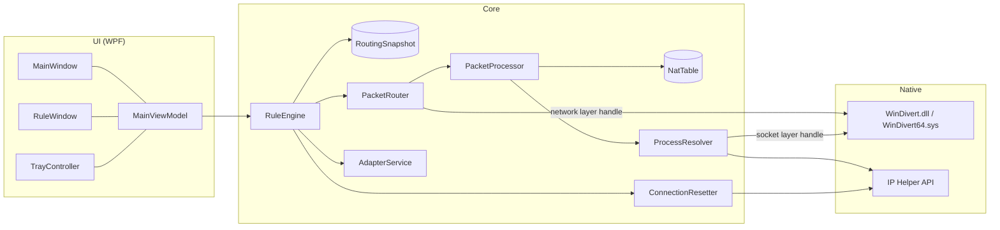

# Architecture

This page is for contributors. For what TrafikRuler does from a user's point of view, see the [README](../README.md).

## Big picture

| Folder | What lives there |
|---|---|
| `src/TrafikRuler/Native` | P/Invoke only: WinDivert (`WINDIVERT_ADDRESS` layout is unit-tested), IP Helper tables and `SetTcpEntry`, process queries. |
| `src/TrafikRuler/Core` | All routing logic. No UI references. |
| `src/TrafikRuler/Config` | `settings.json` persistence and *Start with Windows* via Task Scheduler. |
| `src/TrafikRuler/UI` | WPF views, view models, Fluent theme (`Theme/`), tray icon. |
| `src/TrafikRuler/Assets` | Generated icons — do not edit by hand, see `tools/IconGen`. |
| `tests/TrafikRuler.Tests` | xUnit: packet parsing/rewriting, NAT decisions, native struct layout, UI smoke tests. |

## Packet path

1. **`PacketRouter`** opens one WinDivert handle on the network layer while at least one rule is *Active* or *Blocking*. The filter captures all outbound TCP/UDP (plus non-first IPv4 fragments) and inbound packets addressed to target adapters. With no active rules the handle is closed and nothing is intercepted.
2. Worker threads (`ProcessorCount / 2`, clamped to 2–4) call **`PacketProcessor.Process`** for every packet and re-inject it unless it returns `false`.
3. **Outbound:** the flow key `(protocol, local port, remote address, remote port)` is looked up in **`NatTable`**. A cached decision (`Pass` / `Nat` / `Block`) is applied directly — this is the fast path for unrelated traffic. On a miss, `Decide` resolves the owning process (`ProcessResolver`), matches it against the current `RoutingSnapshot` and records the decision.
4. **`Nat`:** the source address is rewritten to the target adapter's address with a full checksum recompute (outbound packets may carry offloaded, incomplete checksums), MSS is clamped on SYN, and `IfIdx` is set to the target adapter.
5. **Inbound:** replies to the target address are matched back to their flow; the destination is restored with an incremental checksum update (RFC 1624) so corrupted packets stay detectably corrupted.
6. **`Block`:** TCP gets an RST injected towards the local app (and towards the server for established flows); UDP is dropped.

## Rules and snapshots

`RuleEngine` turns settings + current adapters into an immutable `RoutingSnapshot` with a **generation** number. It rebuilds the snapshot when rules change and (debounced) when Windows reports a network change.

- `PacketProcessor.ApplySnapshot` keeps NAT flows that are still valid under the new snapshot and returns the rest; `ConnectionResetter` then resets those connections so apps reconnect over the right path.
- Cached `Pass`/`Block` decisions from an older generation are simply re-decided on the next packet.
- When a rule becomes active, `ConnectionResetter.ResetForRule` resets the app's existing IPv4 connections via `SetTcpEntry`. IPv6 has no equivalent API, so stale IPv6 flows are reset in-band by `PacketProcessor` on their next packet.

## Process resolution

`ProcessResolver` listens to WinDivert **socket-layer** events (`BIND`/`CONNECT`/`ACCEPT`/`CLOSE`) to keep a `port → PID` map that is usually ready before the first packet. If a packet wins the race, it falls back to `GetExtendedTcpTable`/`GetExtendedUdpTable` (throttled to one read per 20 ms). Executable paths are cached per PID together with the process creation time, so PID reuse is detected.

## Threading

- WinDivert worker threads: `PacketProcessor` and `NatTable` are lock-free (`ConcurrentDictionary`, `Interlocked`).
- `RuleEngine.Rebuild` runs on the thread pool, serialized by a lock; it raises `Changed`, which the UI marshals to the dispatcher.
- The UI thread owns the view models; a 1-second `DispatcherTimer` samples counters for the graphs.

## Testing

`dotnet test` runs everything; no administrator rights or WinDivert binaries are needed because tests exercise `PacketProcessor` with a fake resolver and injector.

UI smoke tests can also render screenshots: set `TRAFIKRULER_PREVIEW_DIR` to a folder and run the tests. This is how the images in `docs/assets` are produced.

When changing packet code, add a test that builds the packet with `TestPackets` and checks it with `TestPackets.ReferenceValid` — an independent checksum implementation, so a bug in `Packet` can't hide itself.
